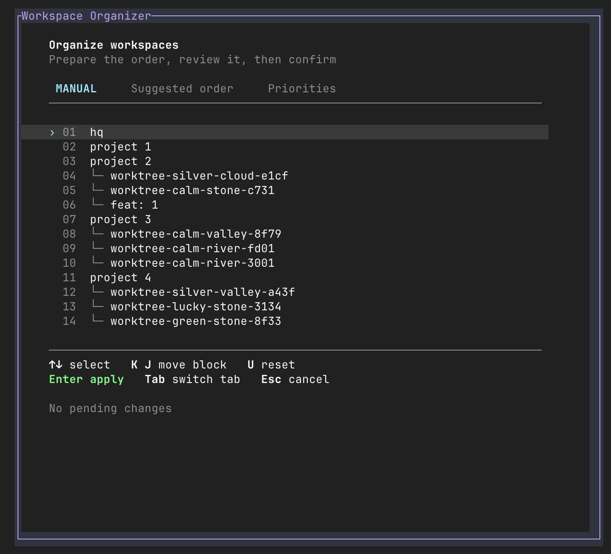

# Herdr workspace organizer

A Herdr plugin for reviewing and changing the order of workspaces. The plugin ID and repository name
are `herdr-workspace-organizer`.

The popup has four tabs:

- **Manual**: pick a workspace and move it in a draft.
- **Suggested order**: preview your category priorities inside repository trees.
- **Priorities**: add, rename, delete, and reorder categories.
- **Move panes**: choose panes on the current Herdr tab and move them into a new Herdr tab or a new
  workspace.

Herdr's workspace order changes only when you apply a workspace draft. Saving priorities changes
the plugin config only. Enter on Move panes does not apply that draft. It moves the unmarked panes
immediately.



## Requirements

- Herdr 0.9.3 or newer
- Node.js 20 or newer and pnpm
- macOS or Linux

## Install

For local development:

```sh
pnpm install
pnpm run build
herdr plugin link "$PWD" --enabled
```

## Open the popup

```sh
herdr plugin pane open --plugin herdr-workspace-organizer --entrypoint organizer --focus
```

Add this binding to `~/.config/herdr/config.toml`:

```toml
[[keys.command]]
key = "prefix+shift+m"
type = "shell"
command = "herdr plugin pane open --plugin herdr-workspace-organizer --entrypoint organizer --focus"
description = "open workspace organizer"
```

Then reload:

```sh
herdr server reload-config
```

Press your prefix, release it, then press Shift+M. Do not use `prefix+w`; that opens Herdr's own
workspace picker.

## Keys

| Key               | Action                                                                     |
| ----------------- | -------------------------------------------------------------------------- |
| Tab               | Switch tabs. This never applies a draft, saves priorities, or moves panes. |
| Up/Down or j/k    | Select an item                                                             |
| Shift+K / Shift+J | Move a workspace or priority up/down. Not used on Move panes.              |
| u                 | Reset the Manual draft. Not used on Move panes.                            |
| a / e / d         | Add, rename, or delete a priority. Not used on Move panes.                 |
| Space             | On Move panes, toggle whether the highlighted pane stays                   |
| s                 | On Move panes, toggle a new Herdr tab or a new workspace                   |
| n                 | On Move panes, edit the topic name                                         |
| x                 | On Move panes, clear stay marks. This does not close the popup.            |
| Enter             | Apply the workspace draft, save priorities, or move panes. See below.      |
| Esc / q           | Cancel and close                                                           |

Enter depends on the tab:

- **Manual** and **Suggested order**: apply the workspace draft and close when it changed.
- **Priorities**: save priorities and stay open.
- **Move panes**: move every pane that is not marked stay. The workspace draft is left untouched.

On Move panes, Enter does nothing else when the topic name is empty (it opens the name editor) or
when every pane is marked stay. A zoomed Herdr tab, or a pane list that changed since the popup
opened, also moves nothing. The first pane fills the new Herdr tab. Each later pane splits the
largest destination pane in half, down when that pane is at least as tall as it is wide, and right
otherwise. `pane.move` is called with focus left unchanged. After every move succeeds, the popup
focuses the new Herdr tab once and closes.

The default destination is a new Herdr tab in the current workspace. `s` switches to a new
workspace. Both use the same topic name. The name is not lowercased. Agents keep running. An
in-flight `agent.wait` ends with `agent_not_running` and is not restarted.

If the move would empty the source, the status line says so before Enter. Herdr closes an empty
Herdr tab. Moving every pane into a new workspace from the only Herdr tab closes that workspace.

While you type a category or a topic name, Enter finishes the text and Esc cancels it. On
Priorities, press Enter again to save. Categories are lowercased, and duplicates are rejected. A
topic name is kept as you typed it.

A failed pane move stops the sequence. Moved panes stay where they are, and the request is not
retried. If the socket times out or drops, the status line says the last request may have
succeeded.

Colors show why a position changed:

- Cyan **moved**: you moved it yourself.
- Yellow **shifted**: it moved because of another move.
- Green **current**: the focused workspace, with no pending move.

The popup has no outer border. It is 86 columns wide and 72% of the terminal tall; the size does not
follow the content.

## Repository trees

Worktree metadata decides the hierarchy, not the spacing in a label.

```text
app
  feat: search
  chore: tests
notes
```

The panel groups worktrees under their repository root, even when `workspace.list` returns them
elsewhere in the flat list. Root order and the relative order of each root's children are preserved.
Opening the panel, cancelling, or pressing Enter without editing does not change the live order.

Moving `app` moves its displayed children together. Moving a child keeps it among its siblings.
The suggested order sorts children inside each repository tree and leaves the roots in place. A
workspace with no visible repository root is not attached to another root automatically.

## Priority config

Default order:

```text
fix → feat → docs → style → refactor → test → build → chore → revert → hotfix
```

Matching ignores case. A label matches when it equals the category or starts with `category:`. For
example, `FEAT: search` matches `feat`, but `feature: search` does not. Children that match nothing
come after the matched children, in their original relative order.

The panel saves to `$HERDR_PLUGIN_CONFIG_DIR/config.json`. The default location is:

```text
~/.config/herdr/plugins/config/herdr-workspace-organizer/config.json
```

Example:

```json
{
  "order": ["hotfix", "fix", "feat", "chore"]
}
```

Saving writes a temporary file and then renames it. A missing config uses the defaults. A broken
config shows an error and is not replaced silently.

## CLI and actions

```sh
node dist/src/cli.js --help
node dist/src/cli.js up
node dist/src/cli.js down
node dist/src/cli.js sort
node dist/src/cli.js sort --prefixes hotfix,fix,feat
node dist/src/cli.js panel
```

`sort` uses the saved priorities unless you pass `--prefixes`. When worktree metadata exists, it
sorts repository children. When it does not, it keeps the flat-list grouping: unmatched workspaces
at the front stay first, the matched categories form one block, and unmatched workspaces after them
follow.

Direct actions change the order right away, unlike the popup, which waits for confirmation:

```sh
herdr plugin action invoke workspace-up --plugin herdr-workspace-organizer
herdr plugin action invoke workspace-down --plugin herdr-workspace-organizer
herdr plugin action invoke sort-workspaces --plugin herdr-workspace-organizer
herdr plugin log list --plugin herdr-workspace-organizer
```

Movement actions use the workspace that Herdr passes in. If you run the script yourself, it uses
`HERDR_WORKSPACE_ID` from that pane.

## Development

```sh
pnpm install
pnpm run validate
pnpm run format
```

See `AGENTS.md` for the rules that must not change and contribution limits.
Aside from installing packages, the plugin downloads nothing at runtime.

## Safety and limits

Reordering does not rename, close, or focus workspaces. Moving past an edge does nothing. Socket
requests time out after five seconds. Failed workspace and pane changes are not retried. Move panes
can leave a Herdr tab empty, which Herdr then closes. A successful move focuses the new Herdr tab
once. A partial move focuses it only when the source Herdr tab or workspace has already closed.

Current limits:

- A draft does not detect changes from other clients before it is applied.
- Long lists do not scroll, so small terminals can cut off content.
- Tree grouping requires the repository root to be visible; orphan worktrees stay standalone.
- Some legacy rendering still uses raw ANSI styling next to Chalk.

Live testing changes your session. Prefer the automated tests. Run live movement tests only with
permission, and restore the original order afterward.
